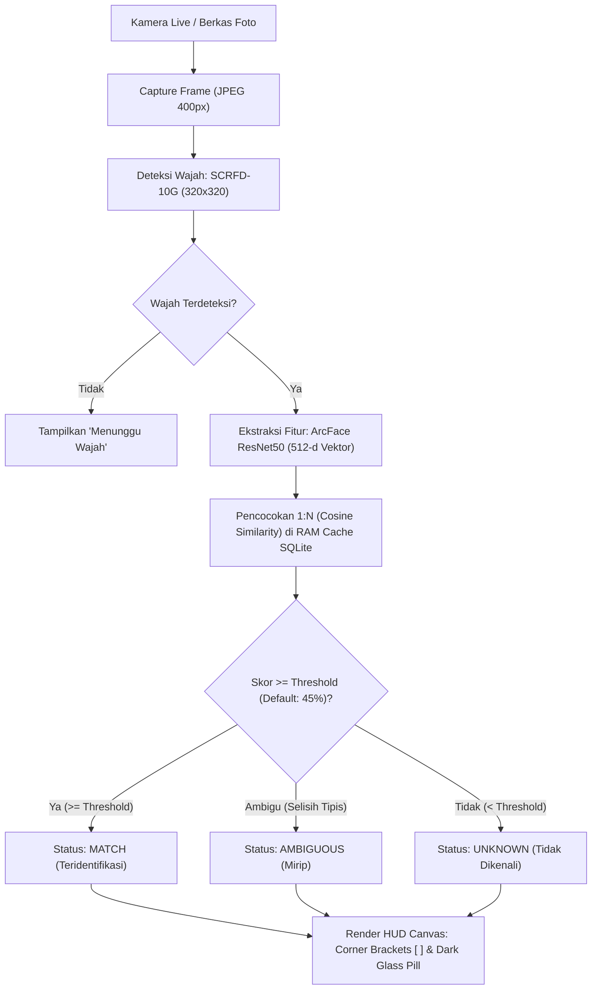
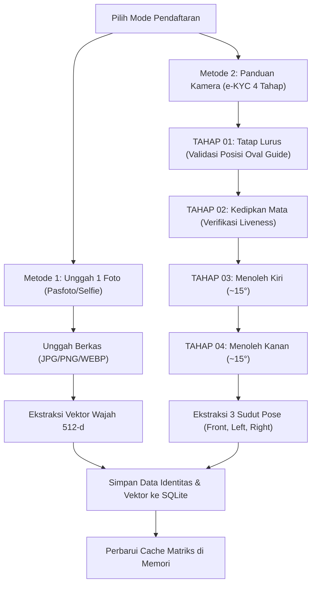

# Identify — Face Identifier with model ArcFace (buffalo_l)

[](https://www.python.org/)
[](https://fastapi.tiangolo.com/)
[-orange.svg)](https://github.com/deepinsight/insightface)
[](https://www.docker.com/)
[](https://coolify.io/)

Sistem biometrik pengenalan wajah (*standalone Face Recognition*) mandiri berkecepatan tinggi yang dirancang untuk **Face Read (identifikasi wajah real-time)** dan **Face Upload (pendaftaran identitas)**. Dibangun menggunakan arsitektur model **InsightFace ArcFace 512-d**, detektor **SCRFD**, validasi keaslian (*liveness anti-spoofing*) **Google MediaPipe**, serta antarmuka web modern bergaya *Luxury Editorial Tech* yang dioptimalkan untuk desktop dan smartphone.

Repository: **[https://github.com/Hyunnism/-Face-Identifier.git](https://github.com/Hyunnism/-Face-Identifier.git)**

---

## 1. Alur Kerja Sistem (System Flows)

### A. Alur Identifikasi Wajah Real-time (Face Read)
Proses identifikasi berkecepatan tinggi (< 80 ms pada CPU) dengan komputasi matriks *Cosine Similarity* terhadap database vektor lokal di memori:



---

### B. Alur Pendaftaran Wajah (Face Upload & e-KYC 4 Tahap)
Mendukung 2 mode pendaftaran yang fleksibel dan aman dari pemalsuan wajah (*anti-spoofing*):



---

### C. Alur Arsitektur Deployment (VMware + Coolify + Cloudflare Tunnel)
Aplikasi di-deploy ke server lokal/private tanpa IP publik, namun tetap aman dan memperoleh HTTPS otomatis untuk izin kamera smartphone:

```mermaid
flowchart TD
    HP["📱 Smartphone Browser (Chrome / Safari)\nhttps://face.domainanda.com"] -->|HTTPS (Wajib untuk Izin Kamera)| CF_Edge["Cloudflare Edge Network\n(Terminasi Otomatis SSL/TLS)"]
    CF_Edge <==|Encrypted Outbound Tunnel|==> CF_Tunnel["cloudflared Daemon di VMware VM\n(Tanpa Port Forwarding / Tanpa IP Publik)"]
    CF_Tunnel -->|HTTP :8000| Coolify["Coolify Engine / Docker Proxy"]
    Coolify --> Container["Container: face-identifier (0.0.0.0:8000)"]
    Container --> Volume[("Persistent Volume Mount\n/app/data/face_system.db")]
```

---

## 2. Spesifikasi Teknis

### Model AI & Algoritma
| Komponen | Model / Pustaka | Spesifikasi & Parameter |
|---|---|---|
| **Face Detection** | InsightFace SCRFD | Model: `SCRFD-10G`, resolusi inferensi: `320x320` untuk akselerasi CPU. |
| **Feature Extraction** | ArcFace (InsightFace `buffalo_l`) | Backbone: `ResNet50 (w600k_r50)`, menghasilkan **512-dimensional normalized embedding vector**. |
| **Matching Algorithm** | Cosine Similarity (Dot Product) | Pencarian 1:N terakselerasi melalui *NumPy Matrix Multiplication* di RAM. |
| **Liveness & Head Pose** | Google MediaPipe FaceMesh | Deteksi kedipan (*Eye Aspect Ratio / EAR*) dan estimasi pose kepala (*Yaw/Pitch*), dengan *fallback* otomatis ke landmark 5-titik SCRFD. |

### Stack Perangkat Lunak
- **Backend**: Python 3.11, FastAPI, Uvicorn, SQLite3, NumPy, OpenCV-Python, ONNX Runtime.
- **Frontend**: Vanilla HTML5, Vanilla CSS (Desain *Luxury Editorial Tech*, tema obsidian `#08080a`, grid responsif smartphone 2x2, **100% bebas emoji**), Vanilla JavaScript.
- **DevOps / Deployment**: Docker (Debian slim), Docker Compose, Coolify, Cloudflare Tunnel (`cloudflared`).

### Kebutuhan Minimum Sistem (System Requirements)
| Sumber Daya | Spesifikasi Minimal | Rekomendasi |
|---|---|---|
| **Sistem Operasi** | Linux (Ubuntu/Debian) / Windows 10/11 | Linux Container (Docker) |
| **CPU** | 1 vCPU / Dual Core | 2 - 4 Cores (Latensi < 80 ms) |
| **RAM** | 2 GB | 4 GB |
| **Penyimpanan** | 4 GB Ruang Kosong | 8 GB+ Ruang Kosong |
| **Konektivitas** | Kamera / Webcam | Mendukung WebRTC `getUserMedia` (Wajib HTTPS di smartphone) |

---

## 3. Struktur Direktori Proyek

```
Face Recognition/
├── src/                          # [BACKEND KODE]
│   ├── app.py                    # REST API FastAPI, health check, static router
│   ├── database.py               # SQLite ORM, volume persistence & RAM cache
│   └── face_engine.py            # AI Engine (SCRFD, ArcFace 512-d, MediaPipe)
├── static/                       # [FRONTEND]
│   ├── index.html                # Halaman muka (Luxury Editorial Tech)
│   ├── css/
│   │   └── style.css             # Tema obsidian, responsif ponsel, zero emoji
│   └── js/
│       ├── camera.js             # Webcam manager, canvas HUD brackets [ ]
│       └── app.js                # Logika antarmuka, tab navigation, e-KYC
├── data/                         # [PERSISTENT STORAGE]
│   └── face_system.db            # Database SQLite (tersimpan lokal/volume)
├── tests/                        # [AUTOMATED TESTING]
│   └── test_system.py            # Unit & integrasi test suite otomatis
├── Dockerfile                    # Image build container (pre-cached model AI)
├── .dockerignore                 # Filter context build Docker
├── docker-compose.yml            # Konfigurasi container service & persistent volume
├── requirements.txt              # Daftar pustaka Python terisolasi
├── run.py                        # Entrypoint lokal dengan auto-delegate .venv
└── README.md                     # Dokumentasi komprehensif sistem
```

---

## 4. Panduan Cara Menggunakan

### Mode A: Menjalankan Secara Lokal (Python .venv)
1. Buka terminal di folder proyek.
2. Jalankan perintah:
   ```bash
   python run.py
   ```
   *(Script otomatis menggunakan virtual environment `.venv` yang terisolasi di folder proyek).*
3. Buka peramban di: **`http://127.0.0.1:8000`**

---

### Mode B: Menjalankan Menggunakan Docker Lokal
1. Build image Docker:
   ```bash
   docker build -t face-identifier .
   ```
2. Jalankan container dengan volume data persisten:
   ```bash
   docker run -d --name face-app -p 8000:8000 -v face_data:/app/data face-identifier
   ```
3. Akses melalui browser: **`http://localhost:8000`**

---

### Mode C: Deployment ke Coolify (VMware) via Cloudflare Tunnel

#### 1. Push Kode ke Repository GitHub
Hubungkan proyek lokal ke GitHub:
```bash
git remote add origin https://github.com/Hyunnism/-Face-Identifier.git
git branch -M main
git push -u origin main
```

#### 2. Buat Resource di Dashboard Coolify
1. Masuk ke Coolify VM Anda (`http://<ip-vmware>:8000`).
2. Buat Resource baru -> **Public/Private Repository** -> Masukkan URL GitHub:
   `https://github.com/Hyunnism/-Face-Identifier.git`.
3. Coolify akan mendeteksi **Dockerfile** secara otomatis.
4. Pada menu konfigurasi:
   - **Exposed Port**: `8000`
   - **Persistent Storage**: Tambahkan volume ke `/app/data` (nama volume: `face_data`).
5. Klik **Deploy**. Model AI akan ter-cache saat build dan kontainer akan langsung menyala sehat (*Healthy*).

#### 3. Hubungkan Cloudflare Tunnel (`cloudflared`)
1. Di Cloudflare Zero Trust Dashboard, tambahkan **Public Hostname** pada tunnel VMware Anda:
   - Subdomain: `face`
   - Domain: `domainanda.com`
   - Service: `HTTP` -> `localhost:8000` (atau IP internal Coolify).
2. Buka di smartphone Anda: **`https://face.domainanda.com`**.
3. Berikan izin akses kamera saat diminta (*Allow Camera Access*), dan sistem siap digunakan langsung dari layar ponsel Anda.

---

## 5. Menjalankan Pengujian Otomatis

Untuk memastikan database, model biometrik ArcFace, pencocokan vektor, dan endpoint API berfungsi sempurna:

```bash
python tests/test_system.py
```

Output pengujian yang berhasil:
```
=== 1. Testing Database & Matching Logic ===
Saved test people with IDs: 1, 2
Database matrix load: PASSED
Exact match test: PASSED (score=1.0000, person=Budi Santoso)
Non-matching rejection test: PASSED (score=0.0582, status=UNKNOWN)

=== 2. Testing FastAPI Endpoints ===
GET /api/people: PASSED (found 1 people)
DELETE /api/people/{id}: PASSED
Database matrix after delete: PASSED

=== 3. Testing InsightFace Engine Initialization ===
InsightFace buffalo_l engine: PASSED

ALL AUTOMATED TESTS PASSED SUCCESSFULLY!
```

---

## 6. Lisensi & Hak Cipta
Dikembangkan untuk kebutuhan identifikasi wajah offline dan mandiri (*on-premise / private cloud*). Bebas dikembangkan dan diintegrasikan sesuai kebutuhan.
