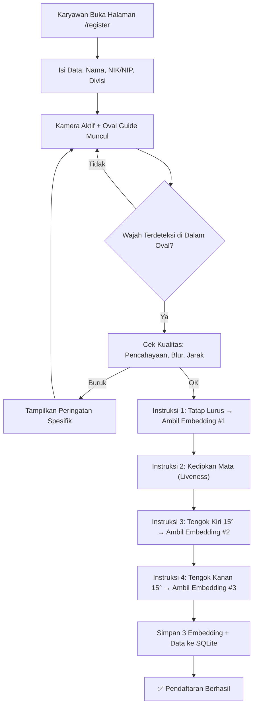
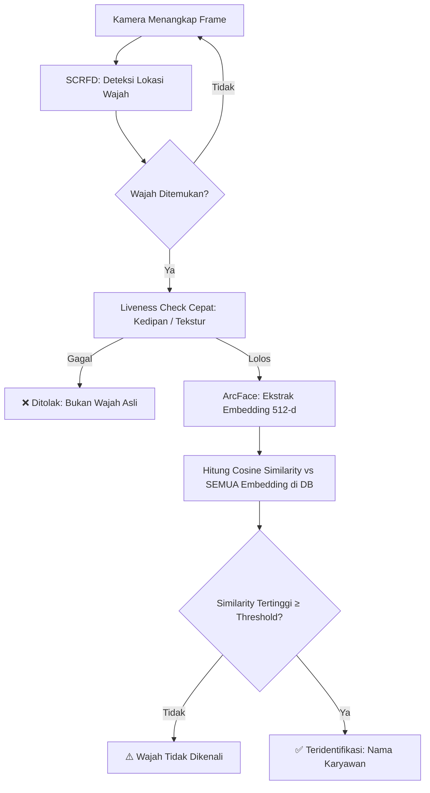
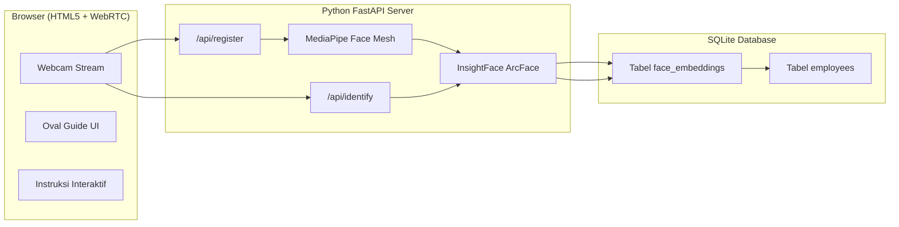

# Face Recognition System — Konsep Lengkap

> Dokumen ini fokus pada **model & pipeline face recognition** saja.
> Sistem absensi (pencatatan jam, dashboard, laporan) dipisah dan dirancang belakangan.

---

## 1. Stack Teknologi (100% Gratis, Offline, Open-Source)

| Komponen | Library | Lisensi | Fungsi |
|---|---|---|---|
| **Face Detection** | InsightFace — **SCRFD** | MIT | Mendeteksi lokasi wajah di frame kamera. Sangat cepat (~5ms/frame di CPU) dan akurat walau wajah miring atau pakai kacamata. |
| **Face Embedding** | InsightFace — **ArcFace (buffalo_l)** | Non-commercial / MIT | Mengubah wajah jadi vektor 512 dimensi. Akurasi LFW ≥ 99.8%. Model ini yang menjadi "otak" pengenalan. |
| **Liveness & Panduan Wajah** | **Google MediaPipe Face Mesh** | Apache 2.0 | 468 landmark wajah real-time. Untuk deteksi kedipan mata, arah kepala (kiri/kanan/lurus), dan kualitas posisi wajah di oval guide. |
| **Backend** | **Python + FastAPI** | MIT | API endpoint untuk enrollment & identification. |
| **Database** | **SQLite** | Public Domain | Menyimpan data karyawan + vektor embedding wajah. Cukup untuk ratusan karyawan. |
| **Frontend Kamera** | **HTML5 + WebRTC + Vanilla JS** | — | Antarmuka kamera di browser, oval guide, instruksi interaktif. Tanpa framework berat. |

> [!NOTE]
> Semua model di-download sekali saja (total ~300MB). Setelah itu sistem berjalan **full offline** tanpa internet.

### Instalasi Dependensi

```bash
pip install insightface onnxruntime mediapipe opencv-python fastapi uvicorn python-multipart numpy
```

---

## 2. Cara Kerja Inti — Face Embedding

Sistem **tidak** menyimpan foto wajah untuk dibandingkan secara visual. Yang terjadi:

1. Foto wajah masuk ke model ArcFace.
2. Model menghasilkan **vektor 512 angka desimal** (disebut *embedding*).
3. Vektor ini adalah "sidik jari digital" wajah — unik per orang, stabil walau ekspresi/pencahayaan berubah.
4. Saat pengenalan, vektor wajah baru dihitung jaraknya terhadap semua vektor di database.

**Rumus Pencocokan (Cosine Similarity):**

$$\text{similarity} = \frac{\vec{A} \cdot \vec{B}}{|\vec{A}| \times |\vec{B}|}$$

- Hasil 1.0 = identik, 0.0 = sama sekali berbeda.
- Threshold yang direkomendasikan: **≥ 0.45** (cosine distance dari InsightFace). Semakin tinggi, semakin ketat.

---

## 3. Alur Pendaftaran Wajah (Enrollment) — Gaya e-KYC Bank

Pendaftaran dilakukan **sekali per karyawan**, dibimbing dengan instruksi interaktif di layar.



### Detail Tiap Langkah:

#### 3.1 Oval Guide & Posisi Wajah
- Di layar tampil lingkaran oval transparan.
- Sistem menggunakan MediaPipe Face Mesh untuk mengukur apakah wajah berada di posisi dan jarak yang benar.
- Jika wajah terlalu jauh/dekat/miring → oval berubah merah + pesan koreksi.

#### 3.2 Quality Gate (Cek Kualitas Otomatis)
Sebelum mengambil embedding, sistem memvalidasi:

| Pengecekan | Metode | Kriteria Lolos |
|---|---|---|
| **Pencahayaan** | Rata-rata brightness piksel area wajah | > 80 dan < 220 (skala 0–255) |
| **Ketajaman (Blur)** | Laplacian variance | > 100 (makin tinggi makin tajam) |
| **Jarak Wajah** | Rasio lebar wajah terhadap lebar frame | 25%–60% dari lebar frame |
| **Posisi di Oval** | Koordinat landmark hidung vs pusat oval | Dalam radius toleransi |

#### 3.3 Liveness Detection (Anti-Spoofing Pasif + Aktif)

**Aktif — Deteksi Kedipan Mata:**
```
Eye Aspect Ratio (EAR) = (|p2-p6| + |p3-p5|) / (2 × |p1-p4|)
```
- Mata terbuka: EAR ≈ 0.25–0.30
- Mata tertutup (kedip): EAR < 0.20
- Sistem mendeteksi transisi terbuka → tertutup → terbuka dalam < 400ms = kedipan valid.

**Aktif — Deteksi Arah Kepala:**
```python
def get_head_direction(landmarks):
    nose_x = landmarks[1].x
    left_cheek = landmarks[234].x
    right_cheek = landmarks[454].x
    ratio = (nose_x - left_cheek) / (right_cheek - left_cheek)
    
    if ratio < 0.38:
        return "KANAN"
    elif ratio > 0.62:
        return "KIRI"
    return "LURUS"
```
- Sistem meminta tengok kiri → validasi ratio > 0.62
- Lalu tengok kanan → validasi ratio < 0.38
- Foto / video playback di HP **tidak bisa merespons instruksi acak ini** → anti-spoofing efektif.

#### 3.4 Penyimpanan Embedding
Setiap karyawan menyimpan **3 embedding** (lurus, kiri, kanan) di database:

```sql
CREATE TABLE employees (
    id          INTEGER PRIMARY KEY AUTOINCREMENT,
    nik         TEXT UNIQUE NOT NULL,
    name        TEXT NOT NULL,
    division    TEXT,
    created_at  DATETIME DEFAULT CURRENT_TIMESTAMP
);

CREATE TABLE face_embeddings (
    id          INTEGER PRIMARY KEY AUTOINCREMENT,
    employee_id INTEGER NOT NULL REFERENCES employees(id),
    pose        TEXT NOT NULL,  -- 'front', 'left', 'right'
    embedding   BLOB NOT NULL,  -- 512 x float32 = 2048 bytes
    created_at  DATETIME DEFAULT CURRENT_TIMESTAMP
);
```

---

## 4. Alur Pengenalan Wajah (Identification 1:N)

Saat karyawan menghadap kamera (di kios absensi atau halaman `/identify`):



### Detail Pencocokan 1:N:

```python
import numpy as np

def identify(query_embedding, all_embeddings, all_employee_ids, threshold=0.45):
    """
    query_embedding: vektor 512-d dari wajah di kamera
    all_embeddings:  array (N, 512) semua embedding di database
    all_employee_ids: list employee_id setiap embedding
    """
    # Cosine similarity = dot product (karena ArcFace sudah L2-normalized)
    similarities = np.dot(all_embeddings, query_embedding)
    
    best_idx = np.argmax(similarities)
    best_score = similarities[best_idx]
    
    if best_score >= threshold:
        return all_employee_ids[best_idx], best_score
    return None, best_score
```

- Karena setiap karyawan punya 3 embedding, satu orang bisa "match" dari embedding pose manapun.
- Sistem mengambil **skor tertinggi** di antara semua embedding, lalu memetakan ke `employee_id`.

---

## 5. Kunci Akurasi — Agar Tidak Salah Orang

### 5.1 Threshold yang Tepat

| Threshold Cosine Similarity | Efek |
|---|---|
| **≥ 0.35** | Terlalu longgar. Bisa salah orang jika karyawan mirip. |
| **≥ 0.45** | **Rekomendasi default.** Seimbang antara akurasi dan kenyamanan. |
| **≥ 0.55** | Ketat. Cocok jika karyawan < 30 orang dan pencahayaan bagus. |
| **≥ 0.60** | Sangat ketat. Mungkin sering gagal jika pencahayaan buruk. |

> [!IMPORTANT]
> Jangan pernah set threshold terlalu rendah demi "kenyamanan". Lebih baik sistem berkata *"Wajah tidak dikenali, coba lagi"* daripada salah mengidentifikasi orang.

### 5.2 Multi-Embedding per Orang
Menyimpan 3 embedding dari 3 sudut (lurus, kiri, kanan) meningkatkan peluang match di kondisi nyata ketika karyawan tidak selalu menghadap kamera persis lurus.

### 5.3 Pencahayaan di Titik Kamera
- Pasang **ring light / panel LED** di dekat kamera kios.
- Hindari backlight (jendela di belakang karyawan).
- Pencahayaan konsisten = embedding konsisten = akurasi tinggi.

### 5.4 Re-enrollment Berkala
- Wajah manusia berubah perlahan (kumis, jenggot, berat badan, kacamata baru).
- Sediakan fitur "Perbarui Data Wajah" yang bisa dijalankan mandiri oleh karyawan setiap 6–12 bulan.

### 5.5 Konfirmasi Visual
- Setelah sistem mengenali wajah, tampilkan nama + foto karyawan di layar selama 3 detik.
- Jika salah, ada tombol "Bukan Saya" → sistem log kejadian dan minta karyawan lapor ke HRD.

### 5.6 Gap Score Check (Pembeda Kembar / Mirip)
```python
# Setelah dapat skor tertinggi, cek selisih dengan skor ke-2
if best_score - second_best_score < 0.05:
    # Dua orang terlalu mirip skornya → minta verifikasi manual
    return "AMBIGUOUS", best_score, second_best_score
```
Ini mencegah salah identifikasi jika dua karyawan kebetulan mirip (saudara kembar, dll).

---

## 6. Arsitektur Keseluruhan



### Endpoint API:

| Method | Endpoint | Fungsi |
|---|---|---|
| `POST` | `/api/register` | Kirim frame wajah (base64) + data karyawan → simpan embedding |
| `POST` | `/api/identify` | Kirim frame wajah (base64) → kembalikan nama & skor kemiripan |
| `GET` | `/api/employees` | Daftar semua karyawan terdaftar |
| `PUT` | `/api/employees/{id}/re-enroll` | Perbarui embedding wajah karyawan |
| `DELETE` | `/api/employees/{id}` | Hapus karyawan + semua embedding-nya |

---

## 7. Spesifikasi Hardware Minimum

| Komponen | Minimum | Rekomendasi |
|---|---|---|
| **CPU** | Intel i3 / Ryzen 3 | Intel i5 / Ryzen 5 |
| **RAM** | 4 GB | 8 GB |
| **Webcam** | 720p | 1080p (Logitech C920 atau setara) |
| **GPU** | Tidak wajib (CPU cukup) | NVIDIA GPU + CUDA = 5–10x lebih cepat |
| **Storage** | 1 GB (model + DB) | SSD lebih baik |

> [!TIP]
> Untuk kantor < 100 karyawan, laptop biasa dengan webcam bawaan sudah cukup. InsightFace + SCRFD berjalan ~15 FPS di CPU modern tanpa GPU.

---

## 8. Ringkasan

| Aspek | Keputusan |
|---|---|
| **Biaya** | \$0 — Semua open-source, offline |
| **Model Utama** | InsightFace ArcFace (buffalo_l) — 512-d embedding |
| **Deteksi Wajah** | SCRFD (bawaan InsightFace) |
| **Liveness** | MediaPipe Face Mesh (kedipan + arah kepala) |
| **Embedding per Orang** | 3 (lurus, kiri, kanan) |
| **Pencocokan** | Cosine Similarity 1:N, threshold ≥ 0.45 |
| **Anti Salah Orang** | Threshold ketat + gap score check + konfirmasi visual |
| **Database** | SQLite (vektor disimpan sebagai BLOB) |
| **Performa** | < 1 detik identifikasi di CPU biasa |
